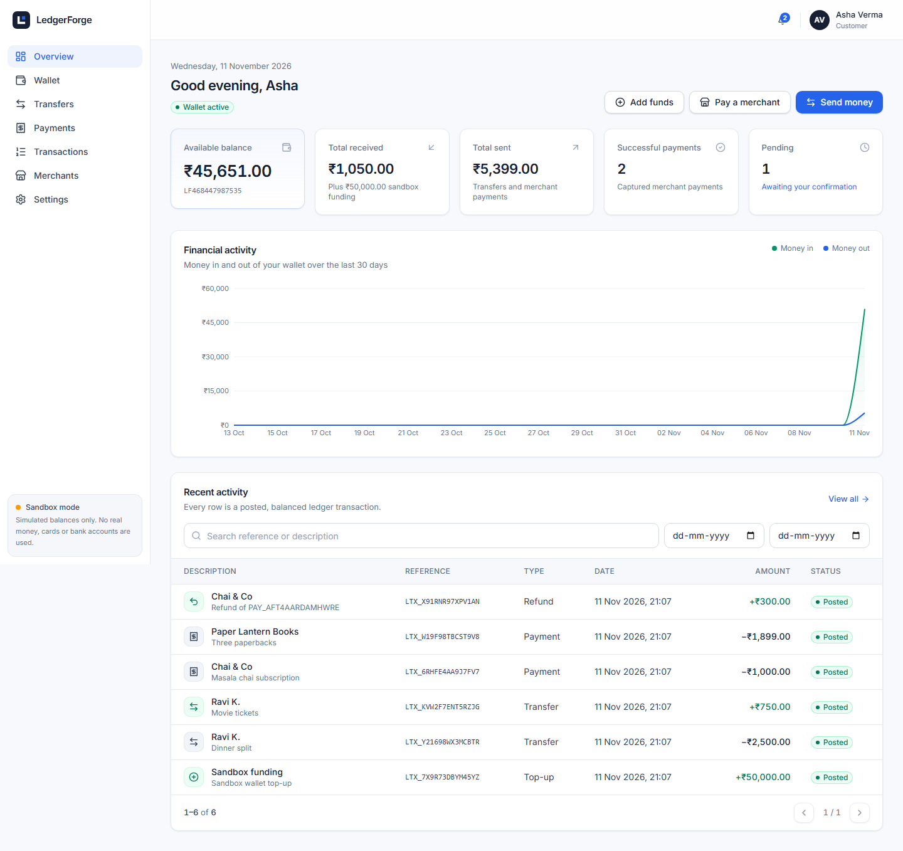
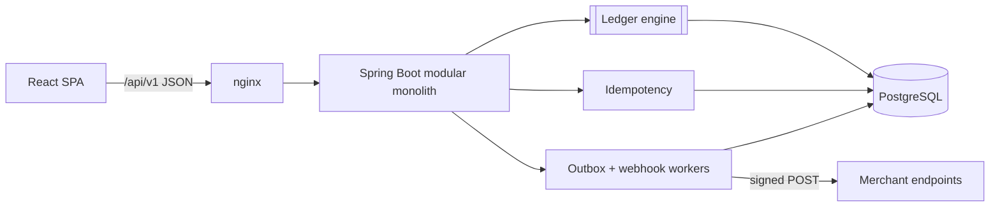
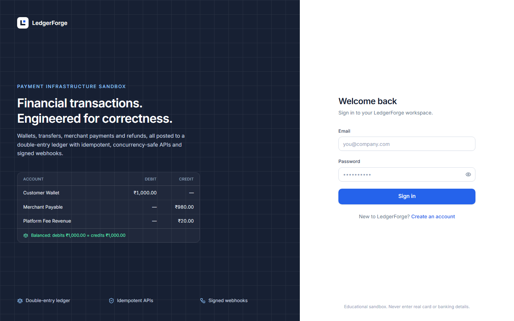
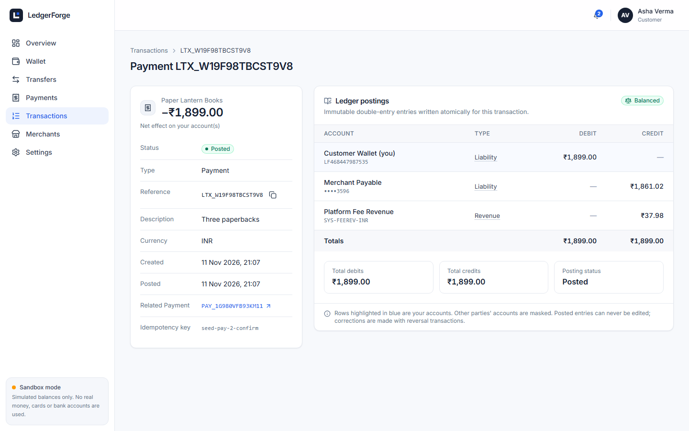
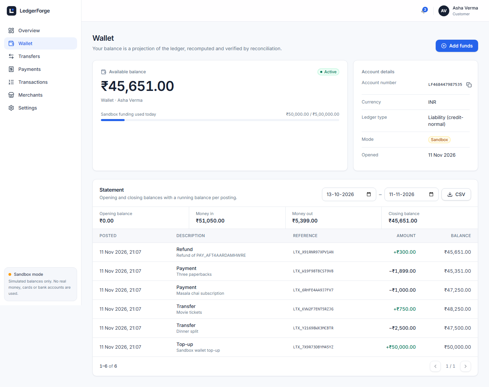
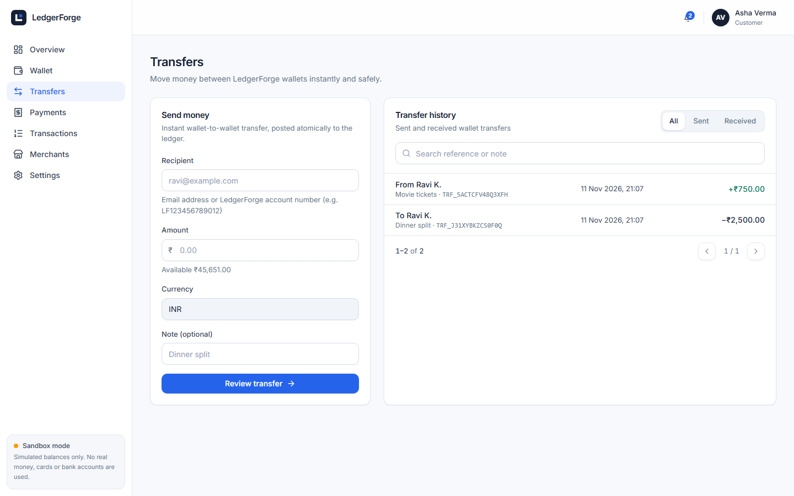
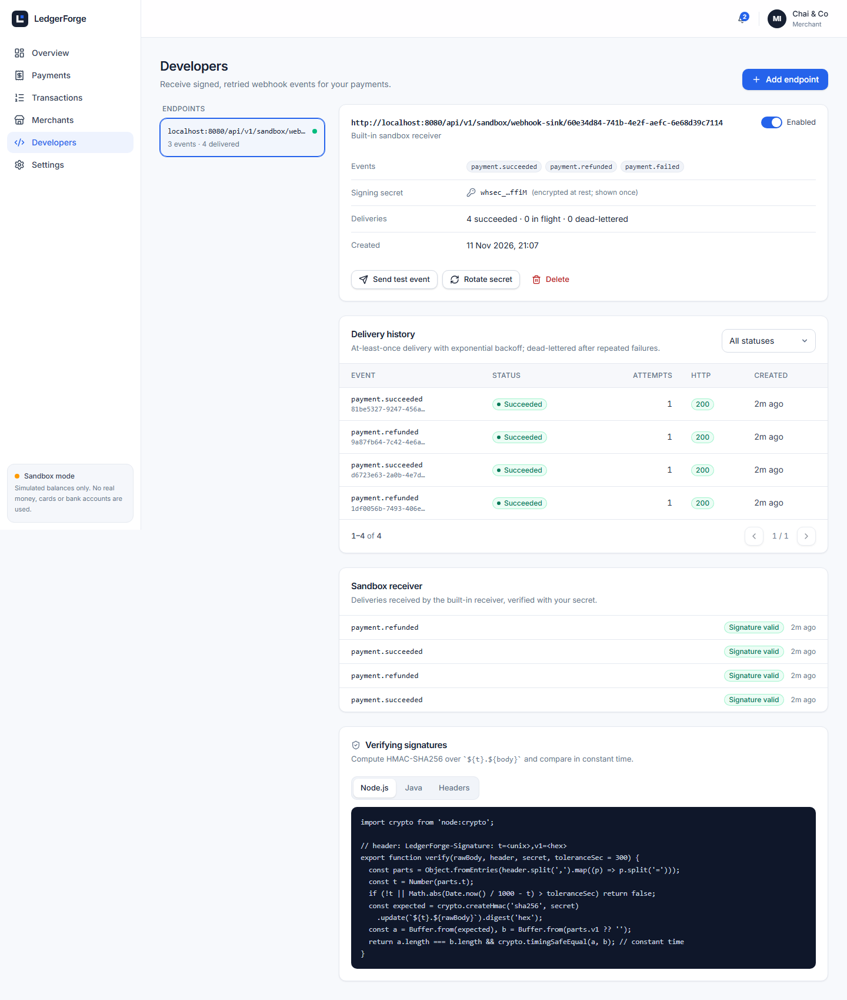
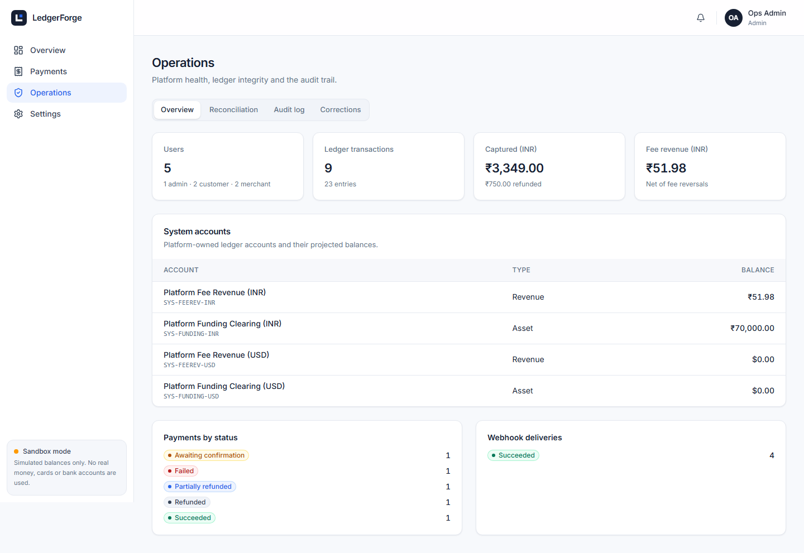
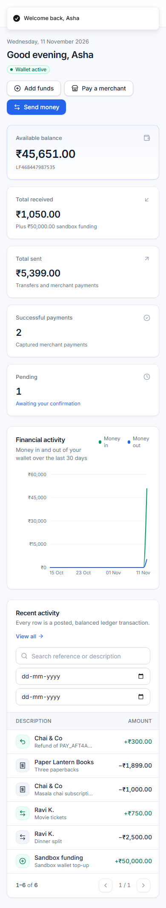
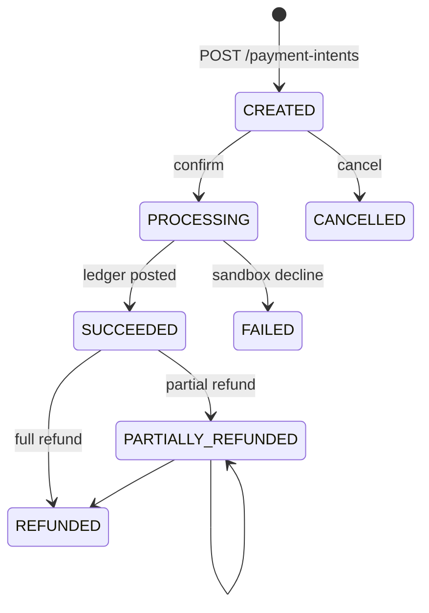

# LedgerForge

**Financial transactions. Engineered for correctness.**

LedgerForge is a payment-infrastructure sandbox. Customers hold digital wallets, transfer funds and
pay merchants. Merchants collect payments, issue full and partial refunds, take payouts and receive
signed webhooks. Every movement of money is posted to a **double-entry ledger** that you can inspect
line by line.

> ⚠️ **Educational sandbox.** All balances are simulated. LedgerForge never processes real money,
> never connects to banking rails, and never collects card numbers, CVVs or bank credentials.
> It is not affiliated with any payment company.



---

## Contents
1. [Problem statement](#problem-statement)
2. [Key capabilities](#key-capabilities)
3. [Architecture](#architecture)
4. [Technology stack](#technology-stack)
5. [Screenshots](#screenshots)
6. [Database schema](#database-schema)
7. [The double-entry ledger](#the-double-entry-ledger)
8. [Idempotency](#idempotency)
9. [Concurrency and locking](#concurrency-and-locking)
10. [Payment lifecycle](#payment-lifecycle)
11. [Refunds](#refunds)
12. [Webhooks](#webhooks)
13. [Security](#security)
14. [API](#api)
15. [Running locally](#running-locally)
16. [Configuration](#configuration)
17. [Tests](#tests)
18. [Demo accounts](#demo-accounts)
19. [Known limitations](#known-limitations)
20. [Future improvements](#future-improvements)

## Problem statement

A wallet balance stored as one mutable number is easy to build and easy to corrupt. Two concurrent
requests overdraw it, a retried request charges twice, and a crash halfway through leaves money that
exists nowhere. Real payment systems avoid this with a few disciplined techniques:
* double-entry bookkeeping;
* atomic database transactions;
* row-level locking;
* idempotency keys;
* transactional outboxes.

LedgerForge implements each of these end to end and proves them with tests that race real requests
against a real PostgreSQL database.

## Key capabilities

* **Double-entry ledger engine:** balanced postings, immutable entries, reversal-only corrections.
  Invariants are enforced in Java *and* by PostgreSQL triggers, including a deferred
  "debits = credits" check at commit.
* **Wallets:** sandbox top-ups with per-transaction and daily limits, and statements with opening,
  closing and running balances, plus CSV export.
* **Transfers:** by email or account number, with recipient confirmation (masked details).
* **Payment intents:** an explicit state machine, server-computed 2% fee snapshot, and a
  deterministic sandbox processor (amounts ending `.13` are declined).
* **Refunds:** full and partial, posted as ledger reversals, with cumulative fee rounding that
  reconciles to the paisa.
* **Merchants:** dashboard, daily reports, fee breakdowns, payouts, and a business profile.
* **Idempotency:** every money-moving POST is idempotent through a database-backed framework.
* **Concurrency safety:** deterministic `SELECT … FOR UPDATE` lock ordering. Double spends,
  double captures and over-refunds are impossible, and tests prove it.
* **Webhooks:** transactional outbox, HMAC-SHA256 signatures, exponential backoff, dead-lettering,
  bounded manual replay, SSRF protection, and a developer console with a payload viewer.
* **Security:** in-memory access JWT, rotating HttpOnly refresh cookie with reuse detection, CSRF,
  role and ownership checks, rate limiting, lockout, and RFC 9457 errors.
* **Operations:** live ledger reconciliation (accounting equation per currency), an audit log,
  and an admin reversal console.

## Architecture



Domain modules (`auth`, `wallet`, `transfer`, `payment`, `refund`, `merchant`, `webhook`, …) never
write ledger rows themselves. They build a `LedgerPostingRequest` and hand it to `LedgerService`,
which must run inside their database transaction. Details are in
[docs/ARCHITECTURE.md](docs/ARCHITECTURE.md).

```
apps/
  api/   Spring Boot 4.1 · Java 21 · Maven · Flyway   (src/main/java/dev/ledgerforge/<module>)
  web/   React 19 · TypeScript · Vite · Tailwind 4    (src/{pages,features,components,services,lib})
docs/    design documents, screenshots, OpenAPI snapshot
.github/workflows/ci.yml
docker-compose.yml
```

## Technology stack

| Layer | Choices |
|---|---|
| Backend | Java 21, Spring Boot 4.1 (Web MVC, Security 7, Data JPA / Hibernate 7, Validation, Actuator, OAuth2 resource server for JWT), Flyway, PostgreSQL 17, springdoc-openapi |
| Frontend | React 19, TypeScript 5.9, Vite 7, Tailwind CSS 4, Radix UI (shadcn-style components), TanStack Query 5, React Router 7, React Hook Form + Zod 4, Recharts 3, Lucide |
| Testing | JUnit 5, AssertJ, Testcontainers (PostgreSQL), Vitest, React Testing Library, Playwright |
| Delivery | Docker (multi-stage, non-root), Docker Compose, nginx, GitHub Actions |

## Screenshots

| | |
|---|---|
|  |  |
| **Sign in** | **Transaction detail with double-entry postings** |
|  |  |
| **Wallet and statement with running balance** | **Send money** |
|  |  |
| **Merchant dashboard** | **Webhook developer console** |
|  |  |
| **Admin operations** | **Mobile** |

## Database schema

Tables: `users`, `refresh_sessions`, `merchant_profiles`, `ledger_accounts`, `ledger_transactions`,
`ledger_entries`, `account_balances`, `transfers`, `payment_intents`, `refunds`, `payouts`,
`idempotency_records`, `outbox_events`, `webhook_endpoints`, `webhook_deliveries`,
`webhook_delivery_attempts`, `audit_logs`.

Conventions:
* amounts are `BIGINT` minor units with an explicit currency;
* timestamps are `TIMESTAMPTZ` in UTC;
* enums are protected by `CHECK` constraints;
* unique constraints cover references and idempotency scopes;
* Hibernate validates the schema and never generates it.

ER diagram and index rationale: [docs/DATABASE_DESIGN.md](docs/DATABASE_DESIGN.md).

## The double-entry ledger

Each account has a normal side. **Assets** (the platform's simulated settlement position) increase
with debits. **Liabilities** (customer wallets and merchant payables: money owed *to* users) and
**revenue** increase with credits. Every ledger transaction has at least two entries, and the
debits equal the credits.

A ₹1,000 purchase with a 2% platform fee:

| Account | Debit | Credit |
|---|---:|---:|
| Customer Wallet (liability) | ₹1,000.00 | |
| Merchant Payable (liability) | | ₹980.00 |
| Platform Fee Revenue (revenue) | | ₹20.00 |
| **Total** | **₹1,000.00** | **₹1,000.00** |

Posted entries can never be updated or deleted; a database trigger rejects it. Corrections are new
reversal transactions. The balance shown to users is a projection, updated in the same transaction
and verified by reconciliation. Full write-up: [docs/LEDGER_DESIGN.md](docs/LEDGER_DESIGN.md).

## Idempotency

Clients send `Idempotency-Key` on every money-moving POST. The server claims the key with
`INSERT … ON CONFLICT DO NOTHING` **inside the same transaction** as the postings:

* **Same key and same body:** the stored response is replayed (`Idempotent-Replayed: true`).
* **Same key, different body:** `409 IDEMPOTENCY_KEY_REUSED`.
* **Concurrent duplicates:** they block on the unique index, then replay.
* **Failed operations:** they leave no record, so the client can safely retry after fixing the cause.

See [docs/IDEMPOTENCY.md](docs/IDEMPOTENCY.md).

## Concurrency and locking

Balance rows are locked with `SELECT … FOR UPDATE` in **ascending account-id order**, after the
payment-intent row. This global order rules out deadlocks between postings. Balance checks happen
under the lock, so this scenario resolves deterministically:

> Balance ₹500, two concurrent ₹400 transfers → exactly one `201`, one `422 INSUFFICIENT_FUNDS`,
> final balance ₹100, ledger balanced.

`ConcurrencyIT` also races 20 spends, 10 identical idempotent requests, 8 confirmations of one
payment, 10 refunds of one payment, a daily limit, and 60 random A↔B transfers. It verifies the
final database state, not just the HTTP codes. See [docs/CONCURRENCY.md](docs/CONCURRENCY.md).

## Payment lifecycle



Confirmation locks the intent, asks the sandbox processor, posts the ledger entries, moves the intent
to `SUCCEEDED` and writes `payment.succeeded` to the outbox, all in **one commit**. A payment is never
marked successful before its postings commit, and it can be captured at most once.

## Refunds

Refunds reference the original capture and post its mirror image for the refunded portion: the
merchant payable and fee revenue are debited, and the customer wallet is credited. Partial-refund fee
reversals use **cumulative floor rounding**, so any sequence of refunds reverses exactly the original
fee and net, with no negative components. A property-based test checks this over random sequences.
Refunds cannot exceed the remaining amount. This is checked under a row lock and again by the
ledger's reversal invariant.

## Webhooks

Events are written to `outbox_events` in the business transaction. A dispatcher fans them out to
subscribed endpoints, and a worker delivers them:
* each payload is signed: `LedgerForge-Signature: t=…,v1=HMAC_SHA256(secret, t.body)`;
* the event id stays stable across retries;
* failures retry with exponential backoff and jitter;
* deliveries are dead-lettered after 8 attempts;
* replay is manual and bounded.

URLs are validated against SSRF at registration and before every send. A built-in sandbox receiver
verifies signatures, so you can see the whole loop locally. See [docs/WEBHOOKS.md](docs/WEBHOOKS.md).

## Security

* The access JWT (10 min) lives in memory only.
* The refresh token is an HttpOnly, SameSite=Strict cookie. It is stored hashed, rotated on every
  use, and a reused token revokes its whole session family.
* The double-submit CSRF check applies to the cookie endpoints.
* Revocation takes effect on the next request.
* Authorization is enforced by role at the URL layer and by ownership inside every query (404, not 403).
* Defenses include BCrypt, per-IP rate limiting, account lockout, a 64 KB body limit, rejection of
  float amounts, a strict CSP, and RFC 9457 errors without internals.
* Production refuses to start with sandbox funding, demo data, insecure cookies or private webhook
  targets enabled.

Full details: [docs/SECURITY.md](docs/SECURITY.md).

## API

REST under `/api/v1`. Swagger UI is at **http://localhost:8080/swagger-ui.html**, and the OpenAPI
snapshot is at [docs/api/openapi.json](docs/api/openapi.json). The endpoint catalogue, error codes
and a curl walkthrough are in [docs/API_DOCUMENTATION.md](docs/API_DOCUMENTATION.md).

## Running locally

### Option A: everything in Docker (recommended)

Requires Docker Desktop or Docker Engine with Compose v2.

```bash
git clone <repo> ledgerforge && cd ledgerforge
cp .env.example .env
# Edit .env: set DATABASE_PASSWORD and a JWT_SECRET of at least 32 random characters,
# e.g. JWT_SECRET=$(openssl rand -hex 32). Optionally WEBHOOK_ENCRYPTION_KEY=$(openssl rand -base64 32).
docker compose up --build
```

* App: **http://localhost:3000**
* API and Swagger: http://localhost:8080/swagger-ui.html
* Health: http://localhost:8080/actuator/health

Compose runs the `dev` profile, which seeds the demo accounts below.

### Option B: run the API and web app from source

Requires Java 21, Node 22+, and Docker (for PostgreSQL).

```bash
cp .env.example .env              # set DATABASE_PASSWORD and JWT_SECRET; FRONTEND_ORIGIN=http://localhost:5173
docker compose up -d postgres     # PostgreSQL on localhost:5432

# API (reads ../../.env automatically; the dev profile seeds demo data)
cd apps/api && ./mvnw spring-boot:run -Dspring-boot.run.profiles=dev

# Web (another terminal): Vite proxies /api to :8080
cd apps/web && npm ci && npm run dev    # http://localhost:5173
```

Helper scripts: `scripts/dev-api.sh`, `scripts/dev-web.sh`, `scripts/test-all.sh`.

## Configuration

| Variable | Purpose | Default |
|---|---|---|
| `DATABASE_URL` / `DATABASE_USERNAME` / `DATABASE_PASSWORD` | PostgreSQL connection | `jdbc:postgresql://localhost:5432/ledgerforge` / `ledgerforge` / none |
| `JWT_SECRET` | HS256 signing key, **≥ 32 bytes** (startup fails otherwise) | none |
| `JWT_ISSUER` / `JWT_AUDIENCE` | validated token claims | `ledgerforge-api` / `ledgerforge-web` |
| `FRONTEND_ORIGIN` | CORS allow-list (comma-separated) | `http://localhost:5173` |
| `APP_ENV` | `development` or `production` (production enables the safety guard) | `development` |
| `SANDBOX_ENABLED` | allow simulated top-ups and payouts (always off in production) | `true` |
| `SEED_DEMO_DATA` | seed demo accounts (dev profile) | `true` in `dev` |
| `WEBHOOK_ENCRYPTION_KEY` | base64 32-byte AES key for webhook secrets (**required in production**) | derived from the JWT secret in dev |
| `PLATFORM_FEE_BPS` | merchant fee in basis points | `200` (2%) |
| `BOOTSTRAP_ADMIN_EMAIL` / `BOOTSTRAP_ADMIN_PASSWORD` | create an admin at startup | unset |
| `COOKIE_SECURE`, `RATE_LIMIT_*`, `IDEMPOTENCY_TTL`, `SANDBOX_MAX_TOP_UP_MINOR`, … | see `apps/api/src/main/resources/application.yml` | |

Profiles: `dev` (seed data, localhost webhooks allowed) and `prod` (sandbox and seed off, Secure
cookies, JSON logs, API docs off).

## Tests

```bash
cd apps/api && ./mvnw verify      # 274 unit tests + 57 integration tests (Testcontainers; Docker required)
cd apps/web && npm test           # 33 Vitest / React Testing Library tests
cd apps/web && npx playwright install chromium && npm run e2e   # Playwright against http://localhost:3000
```

| Suite | What it proves |
|---|---|
| `LedgerValidationServiceTest` | every ledger invariant, including reversal limits |
| `FeeCalculatorTest` | fee rounding; 200 randomized refund sequences reconcile exactly |
| `PaymentStatusTest` | state machine transitions |
| `WebhookSecurityTest` | HMAC sign/verify, tamper and replay detection, 19 SSRF rejections |
| `LedgerEngineIT` | atomic posting, rollback, DB triggers (immutability, deferred balance, currency), reconciliation detects tampering |
| `AuthIT` | registration, login, lockout, refresh rotation, reuse detection, CSRF, logout and password-change revocation |
| `WalletTransferIT` | top-ups, limits, transfers, idempotent replays and conflicts, statements, DB-side filtering and pagination, IDOR |
| `PaymentRefundIT` | fee split, ownership, insufficient funds, declines, double capture, full and partial refunds, payouts, merchant reporting |
| `ConcurrencyIT` | double spend, burst spends, concurrent idempotent requests, confirmations, refunds, daily limit, deadlock-free random transfers |
| `WebhookIT` | signed delivery, fan-out dedupe, retry, backoff, DEAD, replay, isolation, sandbox receiver verification |
| `AdminIT` | admin-only access, reconciliation, audit log, reversal-only corrections, generated OpenAPI |
| Vitest | money parsing and formatting, auth forms, role navigation, transfer and top-up flows (idempotency-key reuse on retry), API client refresh/CSRF, XSS-safe JSON viewer |
| Playwright | register → top up → pay merchant → inspect ledger → merchant partial refund → balances |

CI (`.github/workflows/ci.yml`) runs:
* formatting (Spotless), unit and integration tests;
* frontend lint, typecheck, tests and build;
* `npm audit` and dependency review;
* Docker image builds;
* the Playwright suite against the Compose stack.

## Demo accounts

Created only by the `dev` profile (Docker Compose uses it). Password for all: **`Sandbox-Demo-2026`**

| Role | Email | Notes |
|---|---|---|
| Customer | `asha@ledgerforge.test` | funded wallet, transfers, payments, a refund, one pending payment |
| Customer | `ravi@ledgerforge.test` | includes a sandbox-declined payment |
| Merchant | `merchant@ledgerforge.test` | "Chai & Co": payments, refunds, webhook to the sandbox receiver |
| Merchant | `books@ledgerforge.test` | "Paper Lantern Books" |
| Admin | `admin@ledgerforge.test` | Operations: reconciliation, audit log, corrections |

## Known limitations

* Sandbox only: no real payment processors, no foreign exchange (one currency per account; INR and USD supported).
* The rate limiter is in-process. Multi-instance deployments need a shared store (Redis).
* There is a residual DNS time-of-check/time-of-use window in webhook SSRF checks (see `docs/WEBHOOKS.md`).
* Hot system accounts (fee revenue, funding clearing) serialize their writers under very high load.
* No password reset, email verification or MFA. These are deliberately absent rather than faked.
* Offset pagination. Keyset pagination would suit very deep histories better.

## Future improvements

* Keyset pagination and partitioning of `ledger_entries` by month.
* Sharded or derived system-account balances to remove hot-row contention.
* Redis-backed rate limiting; Kafka or Debezium CDC for the outbox at scale.
* Connect-to-validated-IP webhook egress (or an egress proxy) to close the DNS TOCTOU window.
* Multi-currency wallets with an FX ledger.
* Merchant API keys, so server-to-server integrations can create payment intents.
* MFA (TOTP/WebAuthn), email verification, and password reset with signed single-use tokens.
* OpenTelemetry tracing and Prometheus dashboards.
