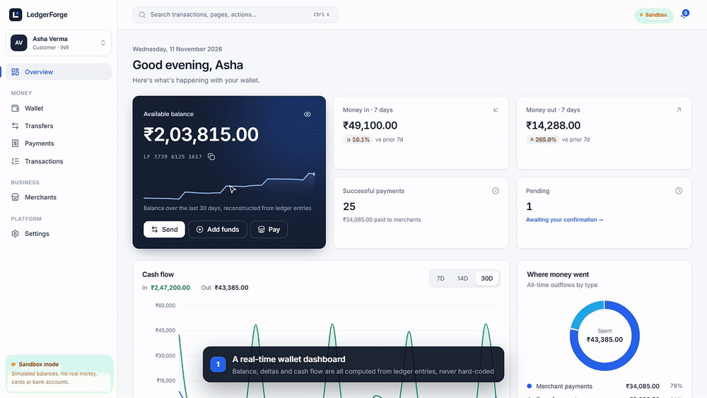
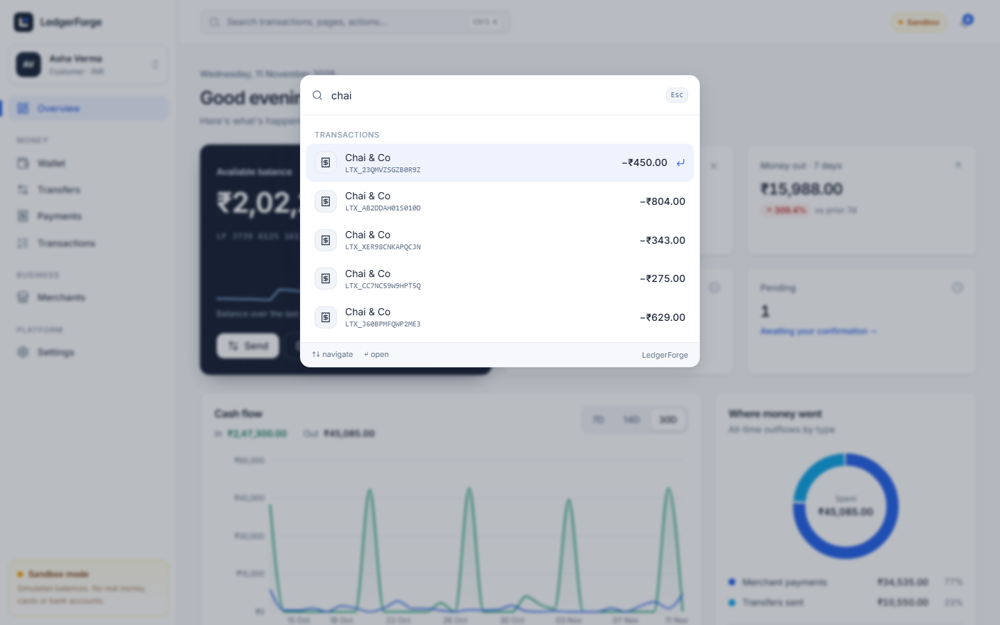
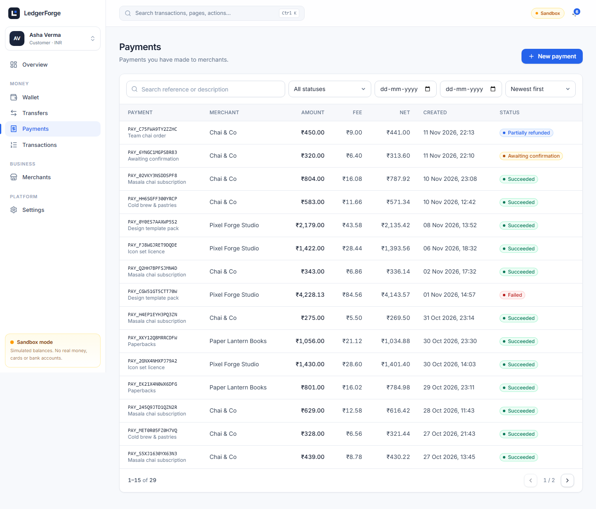
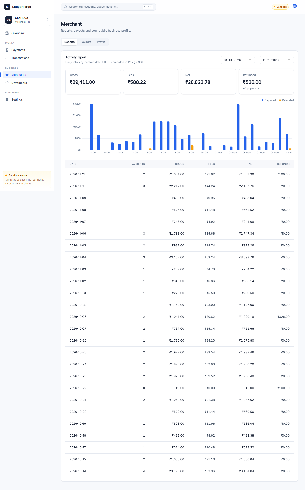
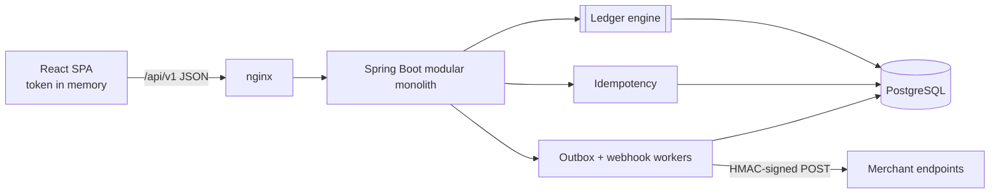
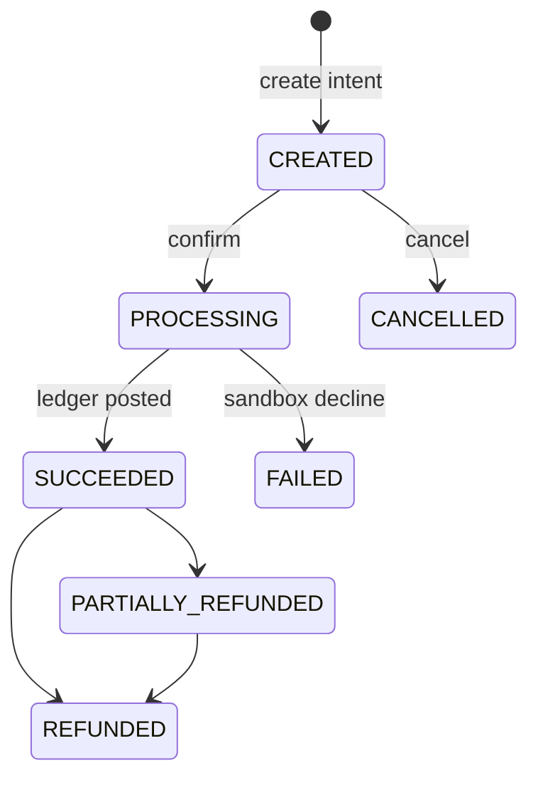

<div align="center">


# LedgerForge

**Financial transactions. Engineered for correctness.**

A payment-infrastructure sandbox: wallets, transfers, merchant payments, refunds, and signed webhooks, all built on a real **double-entry ledger**. It is safe under concurrency, idempotent by design, and backed by 360+ automated tests.

[](https://github.com/10k11/ledgerforge/actions/workflows/ci.yml)


[**▶ Watch the 2-minute demo**](docs/media/ledgerforge-demo.mp4) · [Architecture](docs/ARCHITECTURE.md) · [Ledger design](docs/LEDGER_DESIGN.md) · [API](docs/API_DOCUMENTATION.md) · [Quick start](#quick-start)

<a href="docs/media/ledgerforge-demo.mp4"></a>

</div>

> [!IMPORTANT]
> **Educational sandbox.** All balances are simulated. LedgerForge never moves real money, never connects to banking rails, and never collects card numbers, CVVs or bank credentials. It is not affiliated with any payment company.

---

## Why this project exists

A wallet balance stored as a single mutable number is easy to build and easy to corrupt:
* two concurrent requests overdraw it;
* a retried request charges twice;
* a crash halfway through leaves money that exists nowhere.

Real payment systems survive these failures with a handful of disciplined techniques:
* double-entry bookkeeping;
* atomic transactions;
* deterministic row locking;
* idempotency keys;
* transactional outboxes.

**LedgerForge implements every one of them end to end and proves them with tests that race real HTTP requests against a real PostgreSQL database.**

## Highlights

| | |
|---|---|
| 🧾 **Double-entry ledger engine** | Every money movement posts ≥ 2 balanced entries. Posted entries are immutable, and corrections are reversals. Invariants are enforced in Java **and** by PostgreSQL triggers, including a *deferred* "debits = credits" check at `COMMIT`. |
| 🔒 **Concurrency-safe by construction** | `SELECT … FOR UPDATE` in a global lock order (intent → balances by ascending id). Double-spends, double-captures and over-refunds are impossible, and 7 concurrency tests prove it. |
| 🔁 **Idempotent money APIs** | A database-backed `Idempotency-Key` is claimed with `INSERT … ON CONFLICT` *inside* the business transaction. Concurrent duplicates replay; a reused key with a different body returns `409`. |
| 💳 **Payment lifecycle** | Explicit state machine, server-side fee snapshot (2%), deterministic sandbox processor, full and partial refunds with **cumulative fee rounding** that reconciles to the paisa. |
| 📡 **Signed webhooks** | Transactional outbox → `SKIP LOCKED` workers → HMAC-SHA256 signatures, exponential backoff, dead-lettering, bounded replay, and SSRF protection. |
| 🛡️ **Security-first auth** | Access JWT kept in memory only. The refresh token is a rotating HttpOnly cookie with reuse detection. CSRF protection, instant revocation, ownership checks returning 404 rather than 403, rate limits, lockout, and RFC 9457 errors. |
| 📊 **Production-grade UI** | ⌘K command palette with live ledger search, dashboards computed from ledger entries, a debit → credit money-flow inspector, a webhook developer console, an admin reconciliation console, and mobile layouts. |

## Screenshots

<table>
  <tr>
    <td width="50%"><p align="center"><b>Wallet dashboard</b><br/><sub>Balance history reconstructed from ledger entries, week-over-week deltas</sub></p></td>
    <td width="50%"><p align="center"><b>Ledger inspector</b><br/><sub>Debit → credit money flow and the balanced posting table</sub></p></td>
  </tr>
  <tr>
    <td><p align="center"><b>⌘K command palette</b><br/><sub>Live search across transactions, pages and actions</sub></p></td>
    <td><p align="center"><b>Merchant dashboard</b><br/><sub>Gross, fees, net, refunds and payment success rate</sub></p></td>
  </tr>
  <tr>
    <td><p align="center"><b>Webhook developer console</b><br/><sub>Signed deliveries, attempts, payload viewer, replay</sub></p></td>
    <td><p align="center"><b>Operations console</b><br/><sub>Live reconciliation, system accounts, audit log</sub></p></td>
  </tr>
  <tr>
    <td><p align="center"><b>Send money</b><br/><sub>Recipient verification and an idempotent review step</sub></p></td>
    <td><p align="center"><b>Sign in</b></p></td>
  </tr>
</table>

<details>
<summary>More: wallet statement, payments, merchant reports, mobile</summary>

| Wallet & statement | Payments | Merchant reports | Mobile |
|---|---|---|---|
|  |  |  |  |

</details>

## Quick start

**Requirements:** Docker with Compose v2.

```bash
git clone https://github.com/10k11/ledgerforge.git && cd ledgerforge
cp .env.example .env
# set DATABASE_PASSWORD and JWT_SECRET (≥ 32 chars), e.g. JWT_SECRET=$(openssl rand -hex 32)
docker compose up --build
```

| | |
|---|---|
| App | **http://localhost:3000** |
| Swagger UI | http://localhost:8080/swagger-ui.html |
| Health | http://localhost:8080/actuator/health |

The `dev` profile seeds **30 days of realistic activity**, replayed through the real services. Every account uses the password **`Sandbox-Demo-2026`**:

| Role | Email | What to look at |
|---|---|---|
| Customer | `asha@ledgerforge.test` | Dashboard, ⌘K search, transfers, paying merchants, the ledger inspector |
| Merchant | `merchant@ledgerforge.test` | "Chai & Co": payments, refunds, payouts, webhooks to the built-in receiver |
| Admin | `admin@ledgerforge.test` | Operations: reconciliation, audit log, reversal-only corrections |
| More | `ravi@`, `neha@`, `kabir@`, `books@`, `pixel@ledgerforge.test` | Additional customers and merchants |

<details>
<summary>Run from source instead (Java 21, Node 22+)</summary>

```bash
docker compose up -d postgres
cd apps/api && ./mvnw spring-boot:run -Dspring-boot.run.profiles=dev   # reads ../../.env
cd apps/web && npm ci && npm run dev                                    # http://localhost:5173 (proxies /api)
```
</details>

## Architecture



A **modular monolith** organized by domain: `auth · wallet · transfer · payment · refund · merchant · ledger · idempotency · webhook · audit`.

Domain modules never write ledger rows. They build a `LedgerPostingRequest` and hand it to `LedgerService.post`, which **must** join their database transaction (`Propagation.MANDATORY`). One payment capture is therefore a single atomic commit covering:
* the ledger entries and balance updates;
* the intent's status change;
* the outbox event;
* the audit row;
* the idempotency record.

→ [docs/ARCHITECTURE.md](docs/ARCHITECTURE.md)

## How the money works

A ₹1,000 purchase with a 2% platform fee:

| Account | Type | Debit | Credit |
|---|---|---:|---:|
| Customer Wallet | Liability | ₹1,000.00 | |
| Merchant Payable | Liability | | ₹980.00 |
| Platform Fee Revenue | Revenue | | ₹20.00 |
| **Total** | | **₹1,000.00** | **₹1,000.00** |

* Amounts are `BIGINT` minor units end to end. JSON floats are **rejected**, never truncated.
* Balances are a projection updated in the same transaction and verified by reconciliation:
  **Assets = Liabilities + Equity + Revenue − Expenses**, per currency.
* Refunds are reversals that reference the original. Fee reversals use cumulative floor rounding, so
  any refund sequence reverses *exactly* the original fee and net. This is property-tested over 200
  random sequences.

→ [docs/LEDGER_DESIGN.md](docs/LEDGER_DESIGN.md)

## Correctness under concurrency

> A wallet holds ₹500. Two concurrent ₹400 transfers arrive.
> **Result:** exactly one `201`, one `422 INSUFFICIENT_FUNDS`, a final balance of ₹100, one ledger transaction, and a balanced ledger.

`ConcurrencyIT` races real HTTP requests and then asserts on **database state**:

| Scenario | Guarantee |
|---|---|
| 20 concurrent ₹100 spends from ₹500 | exactly 5 succeed |
| 10 identical requests, same `Idempotency-Key` | 1 transfer, 1 ledger tx, 10 identical responses |
| 8 concurrent confirmations of one payment | captured exactly once |
| 10 concurrent ₹300 refunds of a ₹1,000 payment | exactly 3 succeed |
| 60 random A↔B transfers across 5 wallets | money conserved, zero deadlocks, reconciliation healthy |

→ [docs/CONCURRENCY.md](docs/CONCURRENCY.md) · [docs/IDEMPOTENCY.md](docs/IDEMPOTENCY.md)

## Payment lifecycle



The sandbox processor is deterministic: amounts ending in **.13** are declined, which lets you see the failure path.

## Webhooks

```
LedgerForge-Signature: t=1767225600,v1=<hex HMAC_SHA256(secret, t + "." + body)>
LedgerForge-Event-Id:  <stable across retries — de-duplicate on it>
```

* Events are written to the outbox in the business transaction, fanned out with `FOR UPDATE SKIP LOCKED`, and delivered at least once.
* Retries use exponential backoff with jitter (10s → 1h); deliveries are dead-lettered after 8 attempts and can be replayed a bounded number of times.
* Destination URLs are validated against SSRF (private, loopback, link-local and metadata IPs) at registration **and** before every send.
* Secrets are AES-GCM encrypted at rest and shown once.

→ [docs/WEBHOOKS.md](docs/WEBHOOKS.md)

## Security

* The access JWT (10 min) lives **in memory only**.
* The refresh token is an `HttpOnly; SameSite=Strict` cookie, stored hashed, rotated on every use. Reusing an old token revokes the whole session family.
* Double-submit CSRF protects the cookie endpoints, and revocation takes effect on the next request.
* Authorization is enforced by role at the URL layer and by ownership inside every query (404 rather than 403).
* Further defenses: BCrypt, per-IP rate limits, account lockout, a 64 KB body limit, a strict CSP, and RFC 9457 errors that never leak internals.
* **Production refuses to boot**, before opening a database connection, if sandbox money, demo data, insecure cookies or private webhook targets are enabled.

→ [docs/SECURITY.md](docs/SECURITY.md)

## Tech stack

| Layer | |
|---|---|
| **Backend** | Java 21 · Spring Boot 4.1 (Web MVC, Security 7, Data JPA / Hibernate 7, Validation, Actuator, OAuth2 Resource Server) · Flyway · PostgreSQL 17 · springdoc-openapi |
| **Frontend** | React 19 · TypeScript 5.9 · Vite 7 · Tailwind CSS 4 · Radix UI (shadcn-style) · TanStack Query 5 · React Router 7 · React Hook Form + Zod 4 · Recharts 3 |
| **Testing** | JUnit 5 · AssertJ · Testcontainers · Vitest · React Testing Library · Playwright |
| **Delivery** | Docker (multi-stage, non-root) · Docker Compose · nginx · GitHub Actions |

## Tests

```bash
cd apps/api && ./mvnw verify   # 274 unit + 57 integration tests (Testcontainers, needs Docker)
cd apps/web && npm test        # 36 Vitest / RTL tests
cd apps/web && npm run e2e     # Playwright against the running stack
```

| Suite | Proves |
|---|---|
| `LedgerEngineIT` | Atomic posting and rollback; DB triggers reject unbalanced, mutated or currency-mismatched entries even via raw SQL |
| `ConcurrencyIT` | Double spend, idempotent races, single capture, bounded refunds, deadlock-free transfers |
| `AuthIT` | Rotation, reuse detection, CSRF, lockout, instant revocation |
| `PaymentRefundIT` · `WalletTransferIT` | Fee splits, partial refunds, ownership (IDOR), statements, DB-side pagination |
| `WebhookIT` | Signatures, fan-out dedupe, backoff → DEAD → replay, merchant isolation |
| Vitest · Playwright | Money parsing without floats, idempotency-key reuse on retry, full customer → merchant refund flow |

CI runs formatting, unit and integration tests, frontend lint, types, tests and build, `npm audit`, dependency review, Docker builds, and the Playwright suite against Docker Compose.

## Documentation

| Doc | |
|---|---|
| [ARCHITECTURE.md](docs/ARCHITECTURE.md) | Modules, request lifecycle, runtime topology |
| [LEDGER_DESIGN.md](docs/LEDGER_DESIGN.md) | Debits and credits, chart of accounts, postings, rounding, invariants |
| [CONCURRENCY.md](docs/CONCURRENCY.md) | Transactions, isolation, lock ordering, every race and its guard |
| [IDEMPOTENCY.md](docs/IDEMPOTENCY.md) | Fingerprints, scope, claim-in-transaction algorithm |
| [WEBHOOKS.md](docs/WEBHOOKS.md) | Outbox, signatures, retries, SSRF |
| [SECURITY.md](docs/SECURITY.md) | Auth, CSRF, authorization, headers, secrets |
| [DATABASE_DESIGN.md](docs/DATABASE_DESIGN.md) | ER diagram, constraints, indexes, triggers |
| [API_DOCUMENTATION.md](docs/API_DOCUMENTATION.md) | Endpoints, error codes, examples · [OpenAPI spec](docs/api/openapi.json) |
| [ENGINEERING_DECISIONS.md](docs/ENGINEERING_DECISIONS.md) | Decision records and the alternatives considered |

## Configuration

| Variable | Purpose |
|---|---|
| `DATABASE_URL` · `DATABASE_USERNAME` · `DATABASE_PASSWORD` | PostgreSQL connection |
| `JWT_SECRET` (≥ 32 bytes) · `JWT_ISSUER` · `JWT_AUDIENCE` | Token signing and validation |
| `APP_ENV` · `SANDBOX_ENABLED` · `SEED_DEMO_DATA` | Environment and sandbox behavior (all forced off in production) |
| `FRONTEND_ORIGIN` | CORS allow-list |
| `WEBHOOK_ENCRYPTION_KEY` | AES-256 key for webhook secrets (required in production) |
| `PLATFORM_FEE_BPS` | Merchant fee in basis points (default 200 = 2%) |
| `BOOTSTRAP_ADMIN_EMAIL` · `BOOTSTRAP_ADMIN_PASSWORD` | Create the first admin |

The full list is in [`application.yml`](apps/api/src/main/resources/application.yml) and [`.env.example`](.env.example).

## Known limitations & roadmap

* **Rate limiting:** in-process today; Redis would be needed for multi-instance deployments.
* **Hot system accounts:** the fee and funding accounts serialize their writers; sharded sub-accounts would fix that.
* **Webhook SSRF check:** a small DNS time-of-check/time-of-use window remains; the fix is connect-to-validated-IP egress or a proxy.
* **Pagination:** offset-based; keyset pagination and monthly partitions of `ledger_entries` would suit very deep histories.
* **Missing features:** multi-currency wallets with an FX ledger, merchant API keys, MFA, password reset, and OpenTelemetry tracing.

## License

[MIT](LICENSE). LedgerForge is an educational project; do not use it to process real payments.
