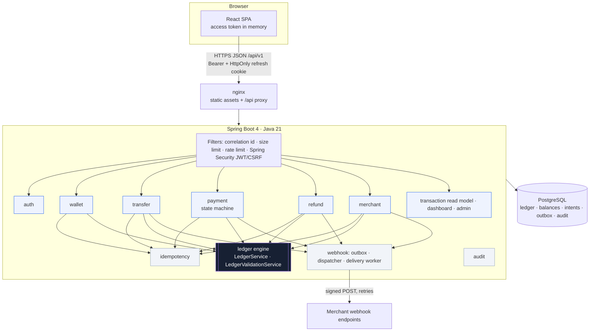

# Architecture

LedgerForge is a **modular monolith**: one deployable Spring Boot application, organized by
business domain, with PostgreSQL as the single source of truth. Microservices would add network
failure modes and distributed-transaction problems that a payments core is better off without at
this scale.



## Modules (`apps/api/src/main/java/dev/ledgerforge`)

| Package | Responsibility |
|---|---|
| `common` | config (`AppProperties`, `ProductionSafetyGuard`), RFC 9457 errors, security (JWT, CSRF, principal), web filters, money math |
| `auth` | register, login, refresh rotation, logout, sessions, password policy |
| `user` | users, account provisioning (user plus ledger accounts in one transaction), party directory |
| `ledger` | **the only writer of ledger entries and balances**; validation; reconciliation |
| `wallet` | wallet view, sandbox top-ups, statements |
| `transfer` | wallet-to-wallet transfers, recipient lookup |
| `payment` | payment intents, state machine, fee calculation, sandbox adapter |
| `refund` | full and partial refunds as ledger reversals |
| `merchant` | profiles, directory, dashboard, reports, payouts |
| `idempotency` | database-backed idempotency for every money-moving POST |
| `webhook` | transactional outbox, fan-out dispatcher, signed delivery worker, SSRF guard, endpoint management |
| `audit` | append-only audit log |
| `transaction`, `dashboard`, `notification`, `admin` | read models and the operations console |
| `seed` | admin bootstrap; dev-only demo data, created through the real services |

**Boundaries.** Domain modules never write `ledger_entries` or `account_balances` themselves. They
build a `LedgerPostingRequest` and call `LedgerService.post`, which must join their transaction
(`Propagation.MANDATORY`). Read models use SQL directly (CQRS-lite): filtering, pagination and
aggregation happen in PostgreSQL.

## Request lifecycle: payment confirmation

```mermaid
sequenceDiagram
    participant C as Customer SPA
    participant P as PaymentService
    participant I as IdempotencyService
    participant L as LedgerService
    participant DB as PostgreSQL
    C->>P: POST /payment-intents/{id}/confirm (Idempotency-Key)
    P->>I: execute(scope, fingerprint)
    I->>DB: INSERT idempotency_records ON CONFLICT DO NOTHING
    P->>DB: SELECT intent FOR UPDATE
    P->>P: state machine CREATED → PROCESSING; sandbox adapter decides
    P->>L: post(debit wallet / credit payable / credit fee revenue)
    L->>DB: lock balances (ascending id), validate, apply, INSERT entries
    P->>DB: intent → SUCCEEDED, INSERT outbox_events, INSERT audit_logs
    I->>DB: UPDATE idempotency_records SET response
    DB-->>C: COMMIT → 200 PaymentIntent
```

Every step shares one database transaction. Failure anywhere means nothing is visible.

## Frontend (`apps/web/src`)

* `lib/api.ts`: fetch wrapper, in-memory token, single-flight refresh, typed `ApiError`.
* `services/`: one typed function per endpoint. `types/api.ts` mirrors the DTOs.
* `features/auth`: session restore on load, login, register, logout.
* `components/ui`: shadcn-style primitives on Radix. `components/shared`: money, status, tables, charts.
* `pages/`: one page per sidebar section; routes are guarded by role in the UI and enforced by the API.
* TanStack Query handles server state. Balances are **never** updated optimistically: after a
  mutation, the affected queries are invalidated and refetched.

## Runtime topology (Docker Compose)

`postgres` (volume, healthcheck) → `api` (non-root JRE, readiness health) → `web` (nginx serving the
SPA and proxying `/api` to the API, so everything is same-origin).

## Observability

* `X-Request-Id` correlation through logs, problem responses, and audit rows.
* Structured ECS JSON logs.
* Actuator: health with readiness (includes the DB) and liveness probes are public; metrics are admin-only.
* Reconciliation (`GET /api/v1/admin/reconciliation`) is the business-level health check.
