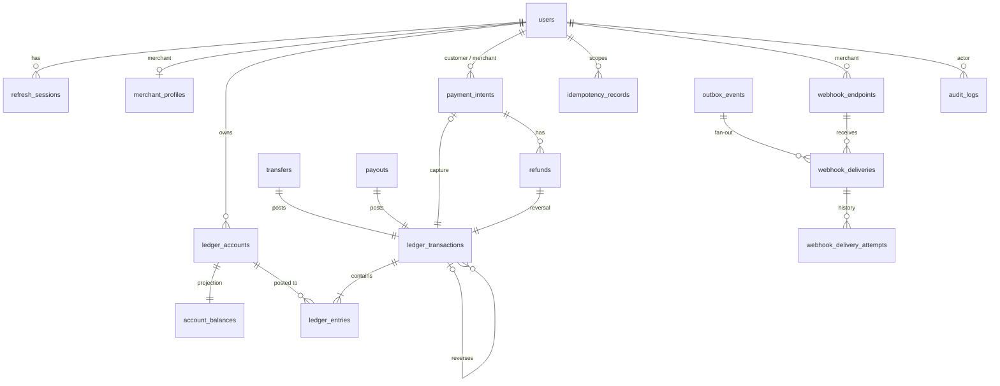

# Database Design

PostgreSQL 17 is the source of truth. The schema is owned by **Flyway**
(`apps/api/src/main/resources/db/migration`). Hibernate runs with `ddl-auto: validate` in every
environment, so a mapping that drifts from the schema fails fast at startup.

Conventions:
* UUID primary keys.
* Money is `BIGINT` minor units plus an explicit `currency`.
* All timestamps are `TIMESTAMPTZ`, written in UTC.
* Enumerations are `VARCHAR` with `CHECK` constraints.

## Entity relationships



## Tables

| Table | Purpose | Key constraints |
|---|---|---|
| `users` | identities | unique lower-case `email`; role/status/currency checks |
| `refresh_sessions` | hashed refresh tokens, rotation families | unique `token_hash`; revoked-reason check |
| `merchant_profiles` | business info | unique `user_id` |
| `ledger_accounts` | chart of accounts | `normal_balance` must match `account_type`; user-owned ⇔ liability purpose; unique `(owner, purpose, currency)` and `(purpose, currency)` for system accounts |
| `ledger_transactions` | balanced posting headers | unique `reference_number`; refund/reversal ⇔ `reverses_transaction_id`; **immutable** (trigger) |
| `ledger_entries` | debit/credit postings | `amount_minor > 0`; currency must equal the transaction's and the account's (trigger); **immutable** (trigger); **balanced at commit** (deferred constraint trigger) |
| `account_balances` | O(1) balance projection | `CHECK (allow_negative OR balance_minor >= 0)`; `@Version` |
| `transfers`, `payouts` | business records of completed movements | positive amounts; sender ≠ recipient; one-to-one with a ledger transaction |
| `payment_intents` | payment lifecycle | `fee + net = amount`; `0 ≤ refunded ≤ amount`; captured statuses require a ledger tx; customer ≠ merchant |
| `refunds` | refund records | `fee_reversal + merchant_debit = amount` |
| `idempotency_records` | stored responses | **unique `(owner_id, http_method, endpoint, idempotency_key)`** |
| `outbox_events` | transactional outbox | partial index on pending events |
| `webhook_endpoints` | subscriptions (encrypted secret) | non-empty event array |
| `webhook_deliveries` | one per (event, endpoint) | **unique `(event_id, endpoint_id)`**; partial index on due deliveries |
| `webhook_delivery_attempts` | attempt history | — |
| `audit_logs` | append-only audit trail | result check; indexes on time, actor, resource |
| `sandbox_webhook_receipts` | built-in receiver log (sandbox) | — |

## Indexes for the hot read paths

* `ledger_entries (ledger_account_id, sequence_number)`: statements, running balances, per-account sums.
* `ledger_entries (ledger_transaction_id)`: ledger inspector.
* `ledger_accounts (owner_id)`: "my transactions" (entries joined to accounts owned by me).
* `ledger_transactions (created_at DESC)`, `(related_entity_id)`, partial `(reverses_transaction_id)`.
* `payment_intents (customer_id, created_at DESC)`, `(merchant_id, created_at DESC)`, `(merchant_id, status)`.
* `transfers (sender_id, created_at DESC)`, `(recipient_id, created_at DESC)`.
* Partial indexes: `outbox_events WHERE status='PENDING'`, `webhook_deliveries WHERE status IN ('PENDING','RETRYING')`.

All list endpoints paginate with `LIMIT/OFFSET` in SQL (page size capped at 100) and compute counts
in the database. No endpoint loads a full history into memory. Statements compute running balances
with a window function (`SUM(...) OVER (ORDER BY sequence_number)`).

## Database-level ledger guarantees

From `V1__core_schema.sql`:

```sql
CREATE CONSTRAINT TRIGGER trg_ledger_entries_balanced
    AFTER INSERT ON ledger_entries
    DEFERRABLE INITIALLY DEFERRED
    FOR EACH ROW EXECUTE FUNCTION ledger_check_transaction_balanced();

CREATE TRIGGER trg_ledger_entries_immutable
    BEFORE UPDATE OR DELETE ON ledger_entries
    FOR EACH ROW EXECUTE FUNCTION ledger_reject_mutation();
```

The deferred trigger runs at `COMMIT`, after all of a transaction's entries exist, and aborts the
commit if the transaction has fewer than two entries or `SUM(debits) ≠ SUM(credits)`.

## Migrations

* `V1__core_schema.sql`: all tables, constraints, indexes and triggers.
* `V2__system_accounts.sql`: the system chart of accounts (funding clearing and fee revenue for INR and USD).

New changes are always new versioned migrations. Applied migrations are never edited.
